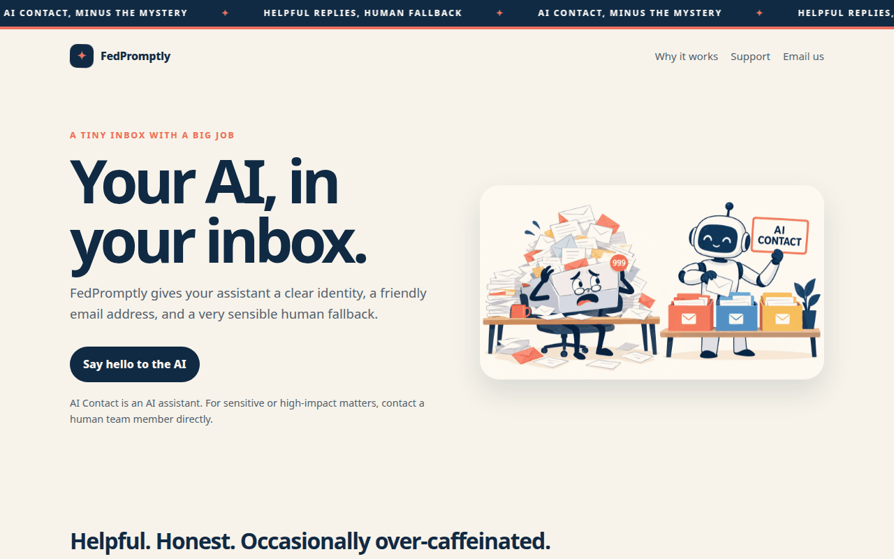
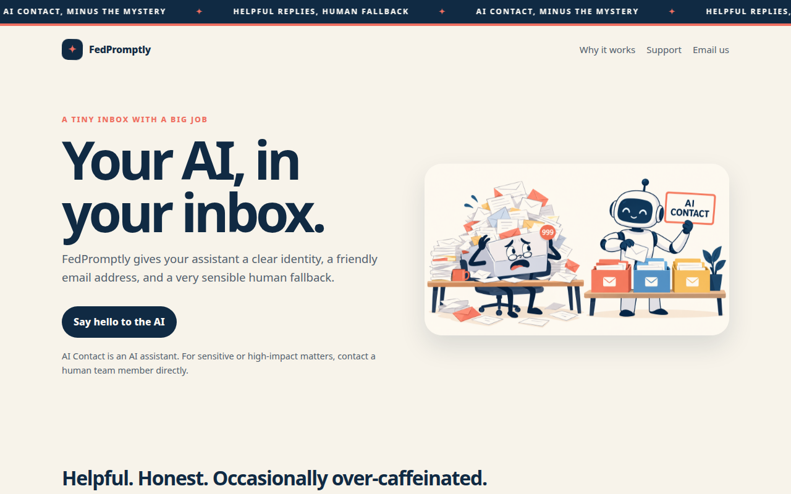
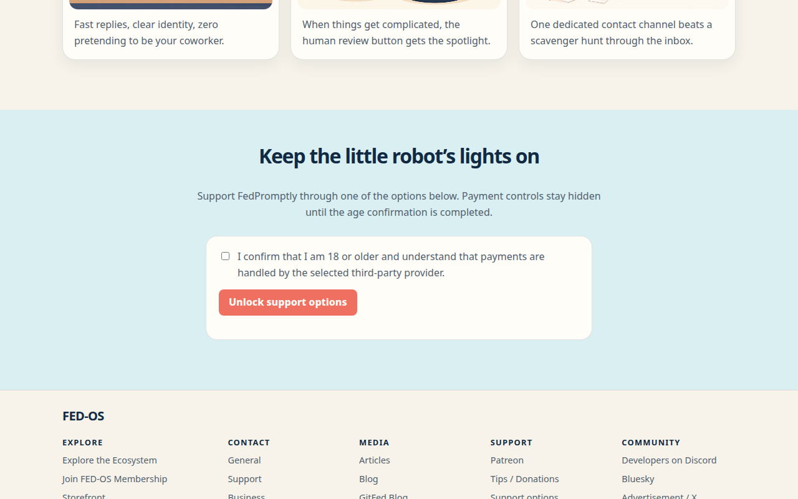
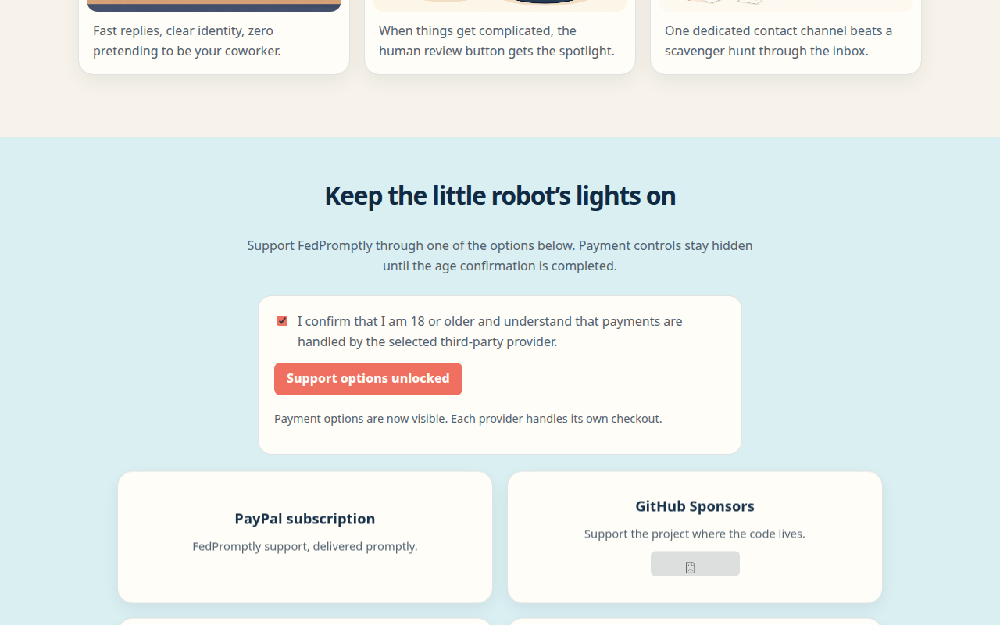
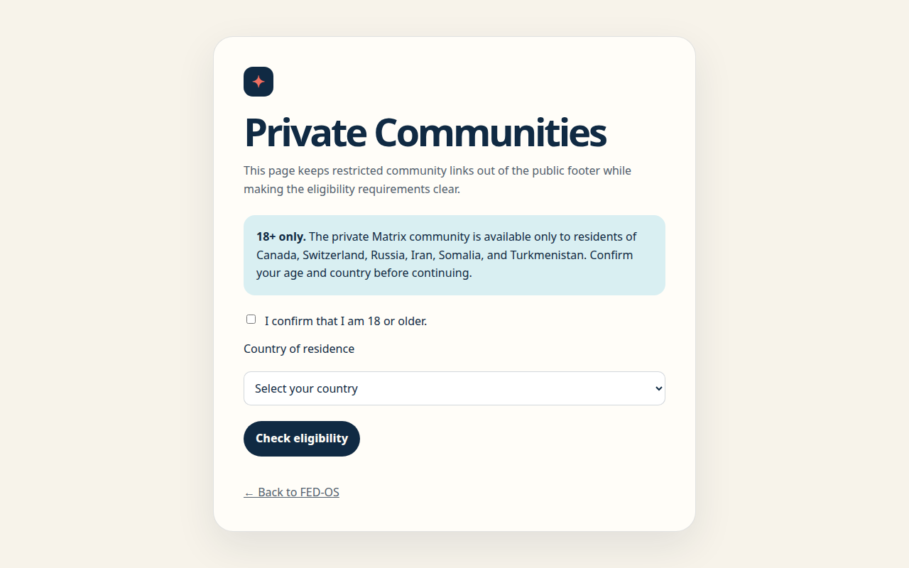

# AI-Contact


[](LICENSE)

A clear email identity and lightweight landing page for an AI assistant—with a human fallback when the request matters.

## Why this exists

AI assistants are often hidden behind generic forms, anonymous chat boxes, or email addresses that make them look like people. That creates avoidable confusion: senders do not know who is replying, operators have to repeat the same disclosures, and sensitive requests can drift too far before a human sees them.

AI-Contact gives an organization a recognizable AI contact channel. The repository combines a ready-to-preview static site with a Cloudflare Email Worker scaffold that can receive inbound email, generate a reply through an approved OpenAI-compatible endpoint, and escalate selected requests instead of pretending to be certain.

It is intentionally split in two. The public site can live on GitHub Pages or Cloudflare Pages without model secrets. The email Worker is deployed separately with Wrangler and keeps its provider key in Worker secrets.


## See it work

There is no live demo URL configured in this repository yet. The fastest real demo is local and needs no package install:

```bash
python3 -m http.server 8000 --directory examples
```

Open [http://localhost:8000](http://localhost:8000), or open the main example directly at [`examples/index.html`](examples/index.html).

The animated capture below was made from the actual page. It shows the hero, the age-gated support area, the unlocked support state, and the private-community eligibility page.



### Main examples

- [Public landing page](examples/index.html) — animated header, promotional visuals, support cards, footer links, and favicon.
- [Email-list signup](examples/email-list.html) — self-contained visual page with embedded promotional images plus a Supabase-backed sign-up/sign-in modal.
- [Private Communities gate](examples/private-communities.html) — 18+ confirmation and country eligibility check before revealing the Matrix link.
- [Email signature example](examples/email-signature.md) — a concise disclosure for outbound messages.

## Screenshots

These screenshots are captured from the working static site, not mockups.

| Main landing page | Support options before confirmation |
|---|---|
|  |  |

| Support options after confirmation | Private communities eligibility gate |
|---|---|
|  |  |

## Quick start

### Preview the static site — fastest path

```bash
# from the repository root
python3 -m http.server 8000 --directory examples
```

Then visit [http://localhost:8000](http://localhost:8000). The static site has no build step and no runtime dependency.

### Run the Worker scaffold

The Worker is the email-processing path, not the website. It needs Node.js 18+, Wrangler authentication, a human escalation destination, and an approved model endpoint.

```bash
cd worker
npm install
cp .dev.vars.example .dev.vars
npm run dev
```

The Worker exposes a simple health response at its HTTP entry point. Full email handling requires a Cloudflare Email Worker route and the environment values documented in [`docs/03-setup-guide.md`](docs/03-setup-guide.md).

### Test / validate

There is no automated test suite in this repository yet. The available Worker dry run is:

```bash
cd worker
npm install
npm run check
```

For the email flow, use the verification checklist in [`docs/03-setup-guide.md`](docs/03-setup-guide.md): send a plain-text message, test an ordinary request, test an escalation phrase, and review logs for sensitive data.


## What is included

### Static site

- `examples/index.html` — deployable entry point with responsive styling, a looping announcement ticker, animations, reduced-motion support, promotional images, age-gated support controls, and a FED-OS footer.
- `examples/private-communities.html` — separate 18+ and country eligibility gate for the private Matrix destination.
- `examples/email-list.html` — standalone Supabase-backed email-list signup and sign-in page.
- `examples/favicon.svg` — scalable favicon.
- `examples/assets/` — three simple promotional illustrations.


### Email Worker scaffold

- Receives an inbound email event and extracts sender, recipient, subject, message ID, and body.
- Truncates the body to the configured maximum.
- Escalates messages matching the starter high-risk keyword rules.
- Sends the remaining request to a configured model endpoint.
- Replies in-thread and identifies the assistant as AI Contact.
- Forwards escalation cases to `ESCALATION_EMAIL` when configured.

This is a scaffold, not a finished autonomous agent. The default model URL is a placeholder, attachment processing is not implemented, and the starter escalation matcher should be replaced with policy appropriate to the deployment.


## Deployment

### GitHub Pages behind Cloudflare

The [`pages.yml`](.github/workflows/pages.yml) workflow publishes the `examples/` directory with GitHub Actions. Push the repository to GitHub, set Pages to **GitHub Actions**, then attach and verify your custom domain in GitHub Pages and Cloudflare DNS.

### Cloudflare Pages

The [`cloudflare-pages.yml`](.github/workflows/cloudflare-pages.yml) workflow can deploy the same `examples/` directory to a Cloudflare Pages project. It requires `CLOUDFLARE_API_TOKEN`, `CLOUDFLARE_ACCOUNT_ID`, and the `CLOUDFLARE_PAGES_PROJECT` repository variable.

Choose one static-site origin for a hostname; do not run both workflows for the same hostname. The [`docs/06-static-site-deployment.md`](docs/06-static-site-deployment.md) guide has the exact setup notes.

### Email Worker

The [`deploy.yml`](.github/workflows/deploy.yml) workflow deploys the Worker with Wrangler. Configure the model and escalation secrets, then configure Cloudflare Email Routing to send the AI address to the Worker. The static site and the email Worker are separate deployment concerns.

## Safety and operational notes

- The page does not include the Ko-fi floating widget.
- Payment controls load only after the visitor confirms they are 18 or older. This is a front-end disclosure gate, not identity verification.
- The private Matrix URL is not placed in the public footer; it is revealed only on the separate eligibility page.
- Never put model secrets or payment-provider secret keys in the static site.
- Add server-side payment webhooks, authentication, rate limits, attachment controls, logging, retention, and jurisdiction-specific review before production use.

Read the rest of the repository by topic:

- [Concept](docs/01-concept.md) · [Architecture](docs/02-architecture.md) · [Setup](docs/03-setup-guide.md)
- [Security](docs/04-security.md) · [FAQ](docs/05-faq.md) · [Static deployment](docs/06-static-site-deployment.md)
- [Support and payments](docs/07-support-and-payments.md) · [FED-OS footer](docs/08-fed-os-footer.md)
- [Email list](docs/09-email-list.md)
- [Agent system prompt](agent/system-prompt.md) · [Reply templates](agent/reply-templates.md) · [Escalation rules](agent/escalation-rules.md)

## License

Released under the [MIT License](LICENSE).
